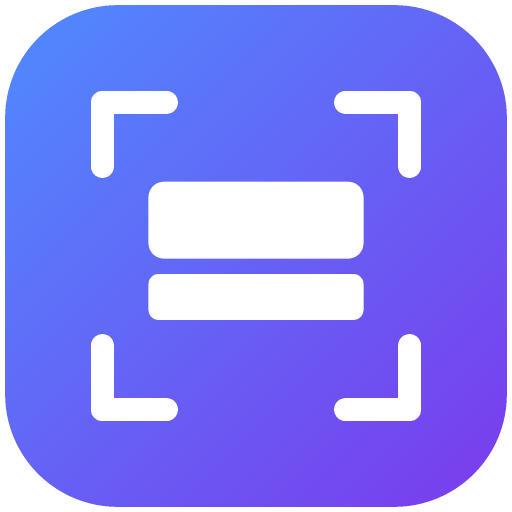

<div align="center">



# CaptureBox

**캡처하고, 꾸미고, 보관하는 Windows 캡처 앱**

[](https://github.com/cybereun)
[](https://github.com/cybereun/CaptureBox/releases/latest)
[](https://github.com/cybereun/CaptureBox/releases)


</div>

---

## 특징

- **4가지 캡처 모드**: 영역 · 창 · 전체 화면 · **스크롤 캡처**(긴 페이지를 자동으로 내리며 한 장으로 이어 붙임)
- **에셋 패널**: 캡처마다 자동 보관. 목록에서 미리보기, 더블클릭 복사, 카톡·문서·폴더로 **끌어서 바로 놓기**
- **편집기**: 사각틀 · 원형틀 · 선/밑줄 · 화살표 · 문자(배경 박스 지원) · 자르기, **그린 주석 선택·이동·삭제·색 변경**, 실행 취소/다시 실행. 편집본은 **새 에셋으로 저장**되어 원본은 그대로 남습니다
- **확대·축소**: 미리보기에서 `Ctrl + 마우스 휠`
- **저장 폴더 지정**: 기본값은 `사진\Screenshots` 폴더. 설정에서 한 번 지정하면 다시 바꾸기 전까지 유지
- **지연 캡처**(3/5/10초), 캡처 후 **자동 클립보드 복사**
- **자동 업데이트**: 새 버전이 올라오면 앱이 알려주고, 클릭 한 번으로 재설치 후 다시 실행

## 설치

1. [**Releases**](https://github.com/cybereun/CaptureBox/releases/latest) 에서 `CaptureBox-Setup-x.x.x.exe` 를 내려받습니다.
2. 실행하면 바로 설치되고 앱이 시작됩니다. (관리자 권한 불필요)
3. 코드 서명이 없어서 처음에 Windows SmartScreen 경고가 뜰 수 있습니다. **추가 정보 → 실행** 을 누르세요.

이후 업데이트는 앱 안에서 자동으로 안내됩니다.

## 사용 방법

### 캡처

| 모드 | 설명 | 단축키 |
|---|---|---|
| 영역 | 화면이 멈추면 드래그로 영역 선택 (Esc 취소) | `Ctrl+Alt+1` |
| 창 | 열려 있는 창 목록(썸네일)에서 선택 | – |
| 전체 화면 | 마우스가 있는 모니터 전체 | `Ctrl+Alt+2` |
| 스크롤 | 스크롤되는 부분만 드래그하면 자동으로 내려가며 이어 붙임 | `Ctrl+Alt+3` |

> 스크롤 캡처는 고정 헤더/사이드바를 제외하고 선택하면 결과가 깔끔합니다. 영상·애니메이션 영역과 무한 스크롤 페이지는 정확도가 떨어질 수 있습니다.

### 에셋 패널

- 클릭: 미리보기 · 더블클릭: 복사 · 끌어서 다른 앱에 놓기
- 이름 변경, PNG/JPG로 저장, 폴더에서 보기, `Delete` 삭제, `Ctrl+C` 복사

### 편집

에셋을 선택하고 **편집** 버튼을 누릅니다.

| 도구 | 키 | 비고 |
|---|---|---|
| 선택 | `V` | 주석을 눌러 이동 · `Delete` 삭제 · 위쪽 색/굵기/크기 변경 |
| 사각틀 / 원형틀 | `R` / `O` | `Shift` = 정사각형 / 정원 |
| 선·밑줄 / 화살표 | `L` / `A` | `Shift` = 45° 단위 고정 |
| 문자 | `T` | 클릭 후 입력, `Enter` 확정 · ‘글자 배경’으로 색 박스 |
| 자르기 | `C` | 드래그 후 `Enter` 로 적용 |

`Ctrl+Z` / `Ctrl+Y` 로 취소·다시 실행, **새 에셋으로 저장** 으로 마무리합니다.

### 설정 ⚙

저장 폴더 변경(기존 캡처도 함께 이동), 업데이트 확인, 사용 도움말.

## 개발

```bash
npm install
npm start        # 실행
npm test         # 스크롤 이어붙이기 로직 테스트
npm run dist     # 설치 파일 빌드 (dist/)
```

> 구글 드라이브 같은 가상 드라이브 위에서는 `npm install` 이 실패할 수 있으니 로컬 디스크에서 실행하세요.

### 릴리즈

1. `package.json` 의 `version` 을 올립니다.
2. `npm run dist` 로 빌드합니다.
3. GitHub Release(태그 `vX.Y.Z`)에 `CaptureBox-Setup-X.Y.Z.exe`, `.blockmap`, `latest.yml` 을 올립니다.

설치된 앱은 시작 후와 30분마다 최신 릴리즈를 확인해 자동으로 내려받고, 알림 카드/푸터의 버튼으로 재설치합니다.

## 라이선스

MIT © [cybereun](https://github.com/cybereun)
